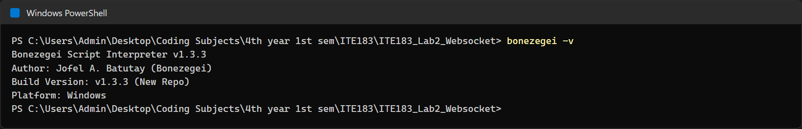
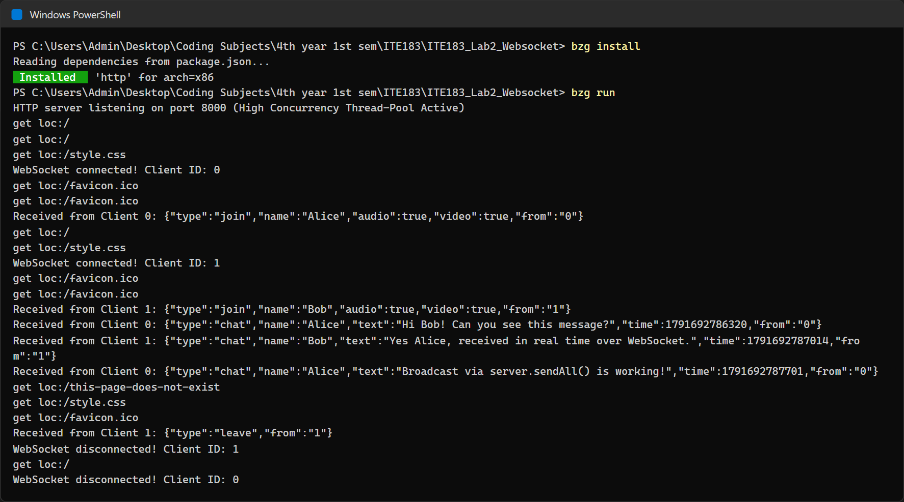
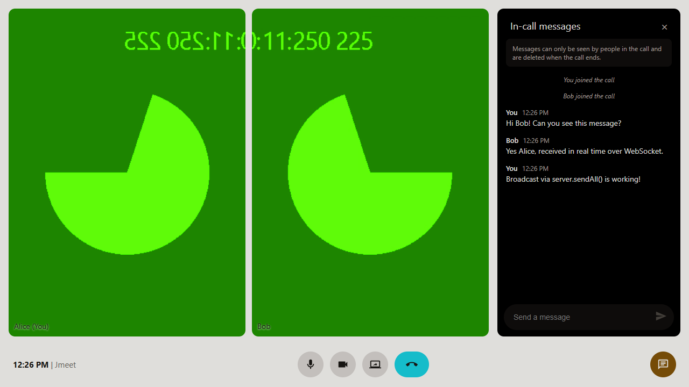
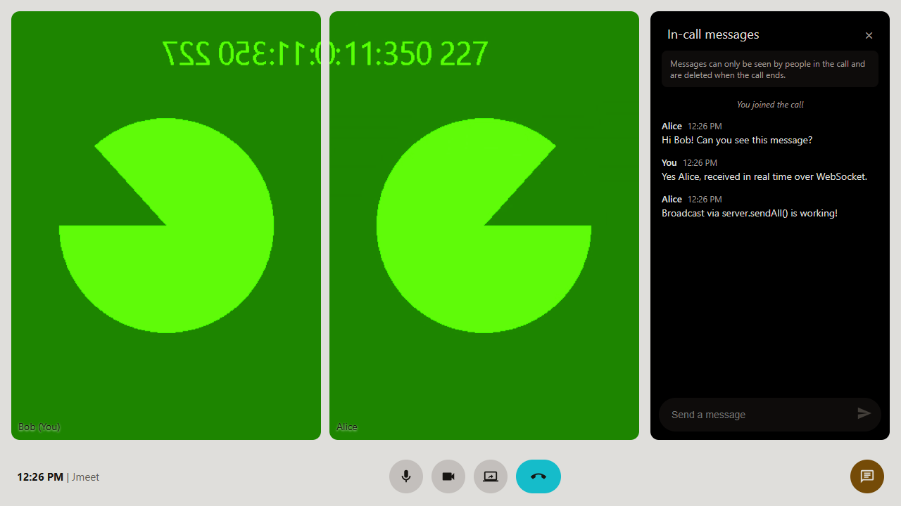
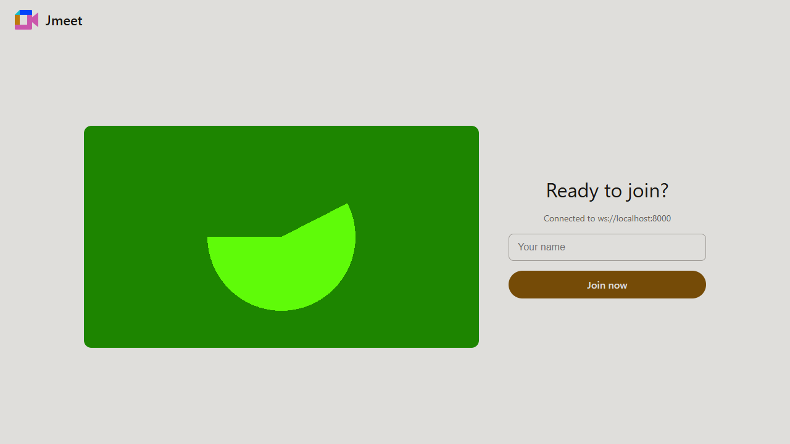
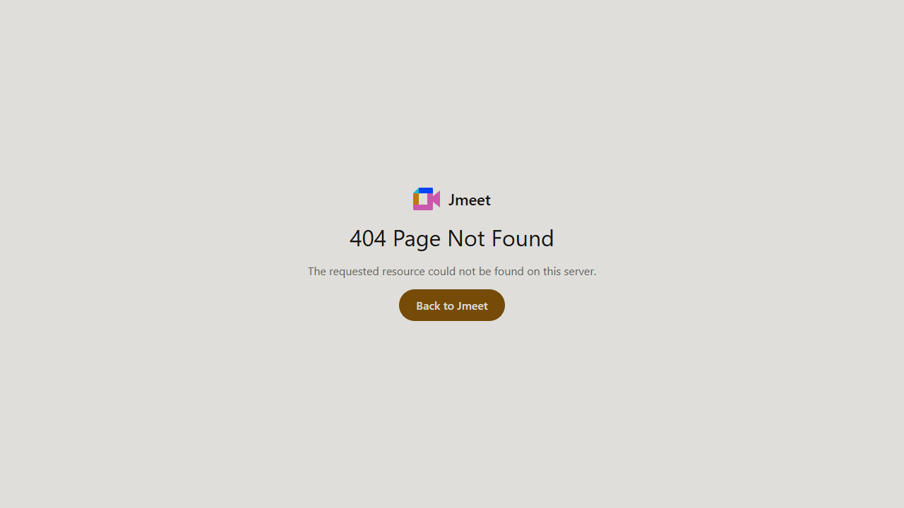

<div align="center">

# Jmeet: Bonezegei WebSocket Server

**ITE183 – Web Systems and Technologies | Laboratory 2: WebSocket Server**

A real-time, multi-client video call and chat app (in the style of Google Meet), powered by an event-driven HTTP + WebSocket server written in the **Bonezegei Scripting Language (v1.3.3)**.


</div>

---

## Table of Contents

- [Overview](#overview)
- [Laboratory Objectives](#laboratory-objectives)
- [Features](#features)
- [Screenshots & Deliverables](#screenshots--deliverables)
- [Requirements](#requirements)
- [Installation & Running](#installation--running)
- [How It Works](#how-it-works)
- [Project Structure](#project-structure)
- [Server API Reference](#server-api-reference)
- [Laboratory Task Checklist](#laboratory-task-checklist)
- [Troubleshooting](#troubleshooting)
- [License](#license)

---

## Overview

This project implements the Laboratory 2 requirements: a **full-duplex WebSocket server** in Bonezegei that serves static files from `public/`, renders a custom **404 page** for unknown routes, and **broadcasts messages in real time** to every connected client using `server.sendAll()`.

The basic chat client from the lab template was extended into **Jmeet**, a browser-based meeting room:

- The **Bonezegei server** handles the HTTP-to-WebSocket upgrade, assigns each client a unique ID, logs every connection, message and disconnection, and relays chat and signaling messages to all clients.
- **Browsers** exchange audio and video **peer-to-peer over WebRTC**, using the WebSocket server as the signaling channel.

## Laboratory Objectives

| # | Objective | How this project meets it |
|---|---|---|
| 1 | Build and run an event-driven WebSocket server in Bonezegei for full-duplex communication | `app.bzg` registers `onConnect`, `onData`, and `onDisconnect` handlers and runs with `bzg run` |
| 2 | Handle the connection lifecycle: handshakes, client identification, disconnection tracking | Each client receives its ID (`__id__:<id>`) on connect; disconnects are logged and broadcast (`__left__:<id>`) |
| 3 | Broadcast messages in real time across active connections | Every incoming payload is relayed to all clients with `server.sendAll()` |

## Features

- **Real-time multi-client chat** with names, timestamps, unread badge, and pop-up notifications
- **Multi-person video grid** (mesh WebRTC) with name labels and muted-mic indicators
- **Call controls**: microphone and camera toggles, screen sharing, and Leave
- **Join screen** with a live camera preview and connection status
- **Static file serving** for `/` (`index.html`) and `/style.css`
- **Custom 404 page** for every undefined route
- **Server console logging** of HTTP requests, WebSocket connects, messages, and disconnects
- **Message chunking** that keeps large WebRTC payloads under the native module's frame-size limit

---

## Screenshots & Deliverables

> The screenshots below were captured from this project running locally on Windows.

### 1. Bonezegei Version Verification: `bonezegei -v`

Confirms the required interpreter version **v1.3.3** is installed.



### 2. Package Installation & Server Startup: `bzg install` and `bzg run`

`bzg install` reads `package.json` and installs the `http` dependency. `bzg run` starts the server on port **8000**. The log then records two clients (Alice and Bob) connecting, exchanging chat messages, opening an undefined route, and disconnecting.



> WebRTC signaling lines (`offer`/`answer`/`ice` chunks) were left out of this screenshot for readability. They also contain network IP addresses.

### 3. Multi-Client Real-Time Chat

Two separate browser sessions joined the same call. Each message sent by one client is broadcast by the server and shows up immediately in the other client's chat panel.

| Client 1: Alice | Client 2: Bob |
|---|---|
|  |  |

> The video tiles show Chrome's built-in test camera feed, which was used for automated two-client testing.

### 4. Join Screen

The landing page served at `/`. It shows the WebSocket connection status (`Connected to ws://localhost:8000`) and a camera preview.



### 5. Custom 404 Page

Any route the server doesn't define (for example `/this-page-does-not-exist`) gets `public/404.html`.



---

## Requirements

| Requirement | Details |
|---|---|
| Operating system | Windows (64-bit) |
| Runtime | **Bonezegei v1.3.3**, with `bonezegei` and `bzg` on your `PATH` (default: `C:\Program Files\Bonezegei`) |
| Package manager | `bzg` (bundled with Bonezegei) |
| Browser | Any modern browser with WebSocket and WebRTC support (Chrome, Edge, Firefox) |

### Installing Bonezegei

**Windows:** uninstall any previous version, then search for **Bonezegei** in the Microsoft Store and install it.

**Linux / GitHub Codespaces:**

```bash
wget https://github.com/bonezegei/Bonezegei_Scripting_Language/raw/refs/heads/main/Release/Latest/Bonezegei-x86.deb
```

```bash
sudo apt install ./Bonezegei-x86.deb
```

Verify the installation:

```bash
bonezegei -v
```

## Installation & Running

1. **Clone the repository**

   ```bash
   git clone https://github.com/Jevoel16/ITE183_Lab2_Websocket.git
   ```

2. **Install dependencies** (from the project root)

   ```bash
   bzg install
   ```

3. **Start the server**

   ```bash
   bzg run
   ```

   Expected output:

   ```
   HTTP server listening on port 8000 (High Concurrency Thread-Pool Active)
   ```

4. **Open the client:** go to <http://localhost:8000>, enter your name, and click **Join now**. Open a second browser window (or another browser), join with a different name, and start chatting.

> **Camera access:** browsers only allow the camera and microphone on `localhost` or HTTPS. Other devices on your LAN can open `http://<your-ip>:8000` and use chat, but their camera will be blocked over plain HTTP.

> **Note:** always run the server from the project root so that `lib/`, `public/`, and `libwinpthread-1.dll` are found.

---

## How It Works

```
 ┌──────────────┐        WebSocket (ws://localhost:8000)        ┌──────────────┐
 │  Browser A   │ ───── join / chat / offer / answer / ice ───► │              │
 │  (Alice)     │ ◄──────────── server.sendAll() ────────────── │  Bonezegei   │
 └──────┬───────┘                                               │  app.bzg     │
        │                                                       │  (port 8000) │
        │   WebRTC peer-to-peer audio / video                   │              │
        │                                                       │              │
 ┌──────┴───────┐ ───── join / chat / offer / answer / ice ───► │              │
 │  Browser B   │ ◄──────────── server.sendAll() ────────────── │              │
 │  (Bob)       │                                               └──────────────┘
 └──────────────┘
```

### Connection lifecycle

| Event | Server action |
|---|---|
| HTTP `GET /` | Sends `public/index.html` |
| HTTP `GET /style.css` | Sends `public/style.css` |
| HTTP `GET` (any other path) | Sends `public/404.html` |
| `onConnect(clientId)` | Logs the connection and sends `__id__:<clientId>` to that client |
| `onData(message, clientId)` | Logs the message and relays it to everyone with `sendAll` |
| `onDisconnect(clientId)` | Logs the disconnect and broadcasts `__left__:<clientId>` |

### Message protocol

Browsers send JSON messages, which the server relays without changing them. Each browser ignores messages that aren't addressed to it.

| Type | Purpose |
|---|---|
| `join` | Announces a participant's name and media state |
| `chat` | A chat message (name, text, timestamp) |
| `offer` / `answer` / `ice` | WebRTC signaling between two peers |
| `media` | Mic and camera on/off updates |
| `leave` | The participant left the call |
| `chunk` | Part of a large message that was split up (see below) |

**Why chunking?** The native `http.dll` crashes on WebSocket frames somewhere between 8 KB and 16 KB, and a WebRTC offer is often around 9 KB. To stay under that limit, the browser splits any message over 3,000 characters into `chunk` messages and puts them back together when they arrive.

## Project Structure

```
ITE183_Lab2_Websocket/
├── app.bzg               # Server entry point (HTTP + WebSocket handlers)
├── package.json          # Project metadata, dependencies, and the "start" script for `bzg run`
├── .gitattributes        # Treats *.bzg as JavaScript for GitHub syntax highlighting
├── LICENSE               # MIT License
├── libwinpthread-1.dll   # MinGW threading runtime required by http.dll
├── lib/
│   ├── http.bzg          # Loads the native http module
│   ├── http.json         # API description of the http module
│   └── http/
│       └── http.dll      # Native HTTP/WebSocket module
├── public/
│   ├── index.html        # Jmeet client (join screen, video grid, chat)
│   ├── style.css         # Shared styles for index.html and 404.html
│   └── 404.html          # Custom Not Found page
└── screenshots/          # Laboratory deliverable screenshots
```

## Server API Reference

The `http` module (`lib/http.bzg`) exposes:

| Member | Description |
|---|---|
| `http(port)` | Creates a server on the given port |
| `server.get = function (path, data)` | HTTP GET callback |
| `server.post = function (path, data)` | HTTP POST callback |
| `server.sendFile(filename)` | Sends a file to the HTTP client |
| `server.sendResponse(message, type, code)` | Sends a custom HTTP response |
| `server.onConnect = function (clientId)` | Called when a WebSocket client connects |
| `server.onData = function (message, clientId)` | Called when a WebSocket client sends data |
| `server.onDisconnect = function (clientId)` | Called when a WebSocket client disconnects |
| `server.send(clientId, message)` | Sends a message to one client |
| `server.sendAll(message)` | Sends a message to all clients |
| `server.run()` | Starts the server loop (blocking) |

---

## Laboratory Task Checklist

**Task 1: GitHub Repository Setup & Configuration**

- [x] Public repository named `ITE183_Lab2_Websocket`
- [x] Initialized with `README.md` and the **MIT License**
- [x] `.gitattributes` containing `*.bzg linguist-language=JavaScript`

**Task 2: Project File Specifications & Server Implementation**

- [x] `package.json` with the project entry point and `http` dependency
- [x] `app.bzg` serves static assets from `public/`, renders `404.html` for undefined routes, and handles WebSocket upgrades and broadcasts
- [x] `public/index.html` multi-client WebSocket chat client and `public/404.html` custom 404 page

**Task 3: Server Execution & Testing**

- [x] `bzg install` installs the required packages
- [x] `bzg run` starts the server; real-time broadcasting verified across multiple browser windows

## Troubleshooting

### `Failed to install 'http' (code=4)` during `bzg install`

The server is probably still running and has `lib/http/http.dll` locked. Stop the server (press `Ctrl + C` in its terminal), then run `bzg install` again.

### `Failed to load library: lib/http/http.dll`

```
Failed to load library: lib/http/http.dll
Undefined variable http
Error at Line 8: Not a function in simple call context near 'server' (Token IDENT)
```

`http.dll` was built with MinGW and depends on `libwinpthread-1.dll`. Either keep `libwinpthread-1.dll` in the project root (it's included in this repo) and run from there, or add a folder that contains it to your `PATH` (for example `C:\Program Files\Git\mingw64\bin`).

### Port 8000 already in use

Stop the other process using port 8000, or change the port in `app.bzg` (`http(8000)`). The client builds its WebSocket URL from the page's own host, so no change is needed in `index.html`.

---

## License

This project is licensed under the [MIT License](LICENSE).

<div align="center">
<sub>ITE183 – Web Systems and Technologies · Laboratory 2</sub>
</div>
